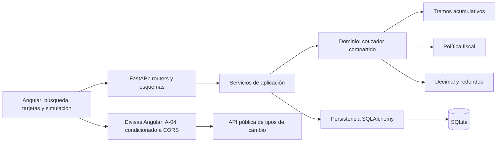

# SaaS-O-Matic — Arquitectura inicial

**Versión:** 0.4. **Estado:** D-01 a D-11 y A-01 a A-07 aprobadas, con los ajustes registrados; sincronización documental para revisión humana. Implementación y verificaciones reales pendientes. Esta tarea no autoriza código, tablas ni migraciones.

## 1. Resumen arquitectónico y justificación

La arquitectura aprobada utiliza un monolito modular FastAPI, una aplicación Angular separada y SQLite mediante SQLAlchemy síncrono. Un único backend mantiene las reglas económicas; Angular gestiona interacción y presentación. Esta separación permite probar el cálculo sin servidor HTTP, base de datos ni acceso a Internet.

Se han leído `AGENTS.md`, [00-project-scope.md](00-project-scope.md), [01-requirements.md](01-requirements.md) y [decision-log.md](decision-log.md). D-01 a D-11 están registradas como aprobadas y sus reglas son coherentes entre la especificación y el registro. Conforme a `AGENTS.md`, el registro determina su estado; las referencias generales a tecnologías propuestas no sustituyen esas aprobaciones. El resumen de alcance no es una transcripción del original de Roams.

D-01 a D-11 conservan su aprobación. A-01 a A-07 están aprobadas según [decision-log.md](decision-log.md), con GB enteros en A-02 y los ajustes de divisas en A-04. [03-api-contracts.md v0.3](03-api-contracts.md) fija los contratos de A-06. A-07 define la ejecución local y evolución del esquema; versiones, codificaciones físicas no fijadas y verificaciones reales siguen abiertas.

Se mantiene un backend modular sin capas ni abstracciones innecesarias, microservicios, infraestructura cloud, Terraform ni autenticación añadida.

## 2. Diagrama Mermaid de alto nivel



Los módulos del backend comparten proceso. El dominio no depende de persistencia ni de HTTP. La consulta externa desde Angular está aprobada en A-04, condicionada a comprobar CORS; no forma parte del motor económico ni está implementada.

## 3. Estructura de carpetas prevista

La estructura concreta la separación de A-01. Este árbol describe archivos futuros, no archivos creados; los nombres y ajustes de organización no alteran las responsabilidades aprobadas.

```text
backend/
  pyproject.toml
  .env.example
  app/
    main.py
    config.py
    api/
      routers/
        customers.py
        simulations.py
      schemas.py
      errors.py
      dependencies.py
    application/
      customers.py
      simulations.py
    domain/
      quotation.py
      pricing.py
      taxes.py
      tax_identifiers.py
      money.py
      errors.py
    persistence/
      database.py
      models.py
      customers.py
      simulations.py
  tests/
    unit/
    integration/
frontend/
  src/app/
    core/
      api/
        customers-api.service.ts
        simulations-api.service.ts
        models.ts
      exchange/
        exchange-rates.service.ts
    features/
      customers/
        customer-search.component.ts
        customer-detail.component.ts
      simulations/
        simulation-form.component.ts
        simulation-history.component.ts
    app.routes.ts
    app.config.ts
```

Las pruebas Angular se ubicarían junto a cada componente o servicio como `*.spec.ts`. Versiones y pasos exactos de arranque se concretarán tras verificarlos en el entorno; no se incorpora una biblioteca de estado global ni una jerarquía genérica de repositorios.

## 4. Responsabilidades de los módulos

| Módulo | Responsabilidad | Límite |
| --- | --- | --- |
| Routers HTTP | Exponer los dos POST, los tres GET y la previsualización aprobados; traducir resultados y errores. | No contienen fórmulas ni consultas SQL. |
| Esquemas de entrada/salida | Validar estructura, tipos y campos; serializar dinero como cadenas decimales exactas. | No sustituyen los algoritmos fiscales. |
| Aplicación | Coordinar alta, consultas, previsualización y guardado; cargar contexto, invocar dominio y delimitar escrituras. | No duplica tramos ni impuestos. |
| Dominio | Cotizador compartido, tramos acumulativos, política fiscal, validadores de identificadores y utilidades monetarias. | Recibe valores; no importa FastAPI, Pydantic, SQLAlchemy ni clientes HTTP. |
| Persistencia | Modelos ORM, consultas concretas y conversión entre importes Decimal y céntimos enteros. | No determina precios ni confirma transacciones por su cuenta. |
| Configuración | Leer ajustes locales y preparar la política fiscal validada para inyectarla al dominio. | No consulta divisas para calcular presupuestos. |
| Angular | Búsqueda, tarjetas responsive, formulario, historial, estados y conversión visual. | Consume importes del servidor; no calcula tramos ni impuestos. |

Los esquemas HTTP Pydantic seguirán A-06: tipos estrictos y `extra="forbid"`, sin coerciones de booleanos, cadenas o fracciones a enteros. Los campos adicionales, incluidos importes aportados por Angular, se rechazan con 422. Los controles de dominio permanecen reutilizables fuera del transporte; las versiones se fijarán tras verificarlas conforme a A-07. [Referencia de FastAPI](https://fastapi.tiangolo.com/tutorial/body/).

**Sesiones y transacciones — A-01/A-07 aprobadas:** usar SQLAlchemy síncrono y una sesión independiente por petición, creada y cerrada por la dependencia HTTP incluso ante errores. Engine y factoría pueden compartirse; las sesiones y sus entidades mutables no se comparten entre peticiones. El servicio de aplicación controla cada transacción de escritura: commit al completar el caso de uso y rollback ante fallo, sin commits en repositorios. La previsualización solo lee y calcula, sin modificar entidades, añadir registros ni confirmar escrituras. La reutilización de conexiones del pool no implica reutilizar sesiones. [Referencia de SQLAlchemy](https://docs.sqlalchemy.org/en/20/orm/session_basics.html).

### Ejecución local e inicialización — A-07 aprobada

Priorizar Windows/VS Code y documentar comandos multiplataforma cuando sea sencillo. Registrar versiones concretas de Python, Angular y dependencias solo después de verificarlas en el entorno; fijarlas en los archivos adecuados al implementar. No hay versiones ni compatibilidades nuevas verificadas en este cierre.

Usar variables de entorno y `.env.example` sin secretos. SQLite tendrá una ruta de archivo estable y un comando explícito de inicialización del esquema mediante SQLAlchemy. El nombre y los pasos exactos del comando se documentarán y verificarán al implementarlo; no crear tablas implícitamente por petición. Alembic no es obligatorio en el MVP: los cambios futuros del esquema exigirán una estrategia de migración.

`persistence/database.py` centralizará Engine, factoría de sesiones y registro por conexión de claves foráneas y `unicode_casefold`. La inicialización explícita no se ejecutará como efecto de una petición HTTP.

Restringir CORS del backend a los orígenes locales concretos y configurables de Angular; no usar `*` con credenciales. El README deberá incluir instalación, configuración, inicialización, arranque y pruebas de backend/frontend con pasos realmente verificados antes de entregar. Nada de ello se ha ejecutado en esta tarea.

### Superficie HTTP ya aprobada

| Endpoint | Caso de uso |
| --- | --- |
| `POST /customers` | Registrar cliente. |
| `POST /simulations/preview` | Calcular sin escritura. |
| `POST /simulations` | Guardar una simulación recalculada. |
| `GET /customers?q=...` | Buscar clientes. |
| `GET /customers/{customer_id}` | Consultar detalle. |
| `GET /customers/{customer_id}/simulations` | Consultar historial original. |

Los métodos y rutas proceden de RF-01/RF-02 y D-04/D-05; A-06 aprueba sus esquemas y errores en los contratos v0.3, sin implementar los endpoints.

## 5. Diseño lógico de datos

A-02 aprueba las dos entidades, claves INTEGER PRIMARY KEY, relación e integridad referencial, unicidad, GB enteros, dinero en céntimos, tasas exactas y fechas UTC. Los nombres HTTP y validaciones se fijan en A-06. Los aspectos físicos no definidos siguen pendientes de implementación; los ejemplos de codificación no son nuevas aprobaciones. Este diseño no crea tablas.

### Customers

| Campo lógico | Tipo lógico / SQLite | Regla |
| --- | --- | --- |
| `id` | Entero / INTEGER PRIMARY KEY | INTEGER PRIMARY KEY aprobado en A-02; generación concreta por definir al implementar A-07. |
| `company_name` | Texto / TEXT NOT NULL | Nombre original para presentación; normalización y longitud en A-06. Sin columna adicional de búsqueda. |
| `tax_identifier_normalized` | Texto / TEXT NOT NULL | Mayúsculas y espacios exteriores eliminados; conserva ceros. |
| `email` | Texto / TEXT NOT NULL | Validación sintáctica, normalización y longitudes según A-06. |
| `country_code` | Texto / TEXT NOT NULL | Dos letras ASCII en mayúsculas, conforme al contrato A-06. |
| `plan` | Texto / TEXT NOT NULL | Obligatorio y validado; sin catálogo ni modificación de tarifas. |

Unicidad conjunta de `country_code` y `tax_identifier_normalized` conforme a D-09. Aplicar la misma normalización al alta y a la búsqueda exacta. La restricción en SQLite debe resolver también altas concurrentes; una comprobación previa en Python no la sustituye.

### Simulations

| Campo lógico | Tipo lógico / SQLite | Regla |
| --- | --- | --- |
| `id` | Entero / INTEGER PRIMARY KEY | Identificador de la simulación guardada. |
| `customer_id` | Entero / INTEGER NOT NULL | Clave foránea a `customers.id`. |
| `active_users` | Entero / INTEGER NOT NULL | De 0 a 1000000, límite de demostración A-06. |
| `storage_gb` | Entero / INTEGER NOT NULL | GB enteros de 0 a 1000000; sin fracciones, A-02/A-06. |
| `api_calls` | Entero / INTEGER NOT NULL | De 0 a 1000000, límite de demostración A-06. |
| `country_snapshot` | Texto / TEXT NOT NULL | País del cliente utilizado para el cálculo. |
| `plan_snapshot` | Texto / TEXT NOT NULL | Plan utilizado, aunque no modifica el precio. |
| `base_cents` | Entero / INTEGER NOT NULL | Base en céntimos, no negativa. |
| `tax_rate_applied` | Decimal exacta / codificación SQLite por concretar | Fracción aplicada, por ejemplo `0.21`; TEXT canónico sigue siendo una opción física no elegida. A-06 fija una cadena decimal exacta en JSON. |
| `tax_cents` | Entero / INTEGER NOT NULL | Importe del impuesto redondeado a céntimos. |
| `total_cents` | Entero / INTEGER NOT NULL | Base más impuesto, en céntimos. |
| `currency` | Texto / TEXT NOT NULL | EUR. |
| `created_at` | Fecha UTC / codificación SQLite por concretar | Generada por el servidor al guardar; A-06 fija ISO 8601 UTC, segundos y sufijo Z en HTTP. |

**Almacenamiento — A-02 aprobada con ajuste**

Guardar `storage_gb` directamente como INTEGER en GB enteros no negativos. No admitir GB fraccionarios ni convertirlos mediante una unidad menor. A-06 fija el máximo de 1000000 para usuarios, GB y llamadas API como límites iniciales de demostración, sin carácter comercial.

A-02 exige clave foránea e integridad referencial y prohíbe eliminar históricos en cascada; concretar la acción física de restricción al implementar el esquema; no se añade un endpoint de borrado. Habilitar las claves foráneas en cada conexión física SQLite antes de iniciar transacciones y comprobar que `PRAGMA foreign_keys` devuelve 1. Si no están activas, impedir operar con esa conexión y comunicar el fallo. [Referencia de SQLite](https://www.sqlite.org/foreignkeys.html).

Mantener restricciones de integridad para enteros no negativos, moneda EUR y coherencia `total_cents = base_cents + tax_cents`; validar GB enteros sin redondear ni truncar fracciones. Comprobar el tipo realmente almacenado de las columnas monetarias y los límites de entero de SQLite. Un índice por cliente y fecha facilitaría el historial; su definición y las restantes concreciones físicas siguen abiertas al implementar A-07. [Tipos y afinidad de SQLite](https://www.sqlite.org/datatype3.html).

**Recorrido monetario aprobado:** calcular la base acumulativa con Decimal; calcular el impuesto y redondearlo a dos decimales con ROUND_HALF_UP; sumar base e impuesto redondeado. Convertir importes ya redondeados a céntimos enteros para guardar. Al responder, devolver cadenas con dos decimales, por ejemplo `108.00`, sin pasar por float ni SQLite REAL.

El país, plan, consumos, tasa e importes guardados proceden de una misma copia del contexto usado al calcular. Las consultas devuelven esos datos originales. No se requiere versionado general de tarifas para preservar los importes ya guardados.

## 6. Flujo de registro de cliente

1. `POST /customers` recibe empresa, identificador, correo, país y plan; el esquema aplica estructura, tipos estrictos y rechazo de campos adicionales según A-06.
2. La aplicación normaliza país e identificador conforme al contrato y D-07. Para España invoca el validador de dominio de DNI, NIE o NIF de entidad; para otros países aplica controles básicos.
3. Comprueba campos requeridos y solicita la inserción mediante persistencia. La restricción conjunta impide duplicados, incluso ante concurrencia.
4. Confirma la transacción y devuelve el cliente; ante conflicto o fallo, revierte y traduce el error.

La ausencia de política fiscal no impide registrar el cliente; bloquea previsualización y guardado del cálculo, conforme a los contratos. El algoritmo de identificación no acredita existencia ni titularidad.

## 7. Previsualización sin escritura

**Backend — D-05; concreción A-01/A-05:** `POST /simulations/preview` recibe cliente y consumos, carga el cliente y obtiene una copia estable de la política fiscal. Invoca el servicio de dominio `quotation`, que combina `pricing`, `taxes` y `money`. Devuelve base, tasa, impuesto y total EUR sin crear una simulación. Los campos de importes aportados por el cliente se rechazan con 422 antes de calcular; el motor aprobado no cambia.

El motor aplica los tramos aprobados; el plan, almacenamiento y llamadas no añaden cargos. ES aplica 21 %, FR 20 % y DE 19 %. Un país sin política produce un error, sin asignarle 0 %. La divisa seleccionada para visualizar no cambia el país fiscal ni la tasa.

El frontend mostrará inicialmente ES, FR y DE como países soportados para calcular e informará si el país del cliente queda fuera. El backend rechazará explícitamente el cálculo, tanto en previsualización como en guardado, para países sin política; la selección de la interfaz no sustituye esa comprobación.

**Angular — D-05 y A-03 aprobadas:**

1. Reactive Forms y `valueChanges` generan una copia de los valores relevantes: cliente, usuarios, GB, llamadas y validez del formulario.
2. Al cambiar esas entradas, invalidar de inmediato el carácter vigente del cálculo anterior. Comparar contenidos, no solo referencias de objetos.
3. Aplicar `debounceTime(300)` y `switchMap` para la solicitud más reciente. Un estado inválido debe cancelar o sustituir la solicitud anterior sin iniciar otra; no filtrarlo dejando una respuesta antigua vigente.
4. Asociar petición y respuesta a la revisión de entradas; ignorar respuestas de revisiones anteriores también durante la espera del debounce. Mantener carga, error y resultado vinculados a esa revisión.
5. Capturar errores sin cerrar el flujo de futuros ajustes y liberar suscripciones al abandonar la pantalla. La cancelación del cliente no garantiza detener trabajo ya iniciado en el servidor.

Los 300 ms iniciales podrán ajustarse tras pruebas de experiencia de usuario, como establece D-05. [Reactive Forms de Angular](https://angular.dev/guide/forms/reactive-forms) y [comportamiento de switchMap en RxJS](https://raw.githubusercontent.com/ReactiveX/rxjs/7.x/src/internal/operators/switchMap.ts).

## 8. Guardado y consulta del historial

**Guardar:** una acción explícita envía `POST /simulations` con la copia actual de cliente y consumos. La aplicación vuelve a cargar su contexto y llama al mismo servicio de dominio que la previsualización; no reutiliza un total de Angular ni llama al endpoint HTTP de preview. Persiste entradas y resultado original dentro de una transacción y responde con el resultado guardado, ID y fecha.

Entre previsualización y guardado puede cambiar la política configurada. El resultado recalculado al guardar es el que se conserva y muestra; el diseño no garantiza reservar una previsualización anterior.

**Consultar:** los tres GET de D-04 leen cliente, detalle e historial según A-06. Empresa: coincidencia parcial Unicode sin eliminar acentos mediante `unicode_casefold` de Python registrada en cada conexión SQLite e `instr` sobre nombre y término normalizados. Conservar el nombre original, enlazar parámetros y tratar `%`/`_` literalmente; NOCASE no ofrece casefold Unicode completo. Puede escanear filas y requerirá revisión si crece el volumen; no añadir una columna de búsqueda. Identificador fiscal: coincidencia exacta normalizada, sin validar el control del término de búsqueda.

El historial devuelve las copias económicas del cliente sin invocar el motor ni la API de divisas. Orden: fecha e ID descendentes; clientes por ID ascendente. Ambas colecciones usan limit=20, máximo 100, y offset=0 por defecto; las vacías responden 200 con items vacíos. Los esquemas completos y la semántica de q están fijados en los contratos v0.3.

A-03 establece el bloqueo de dobles envíos durante el guardado. Se mantiene el tratamiento de respuestas inciertas sin reintentar automáticamente; el contrato HTTP está aprobado en A-06. Un fallo de red no demuestra que el servidor no haya guardado; consultar el historial antes de repetir evita decisiones basadas en un éxito supuesto.

## 9. Integración de tipos de cambio

**Aprobado en D-08:** EUR es base y persistencia; EUR/USD/GBP son las divisas iniciales. La API pública aporta tipos y se muestra la fecha de la tasa. EUR sigue disponible si falla el servicio externo.

**Proveedor inicial aprobado con ajustes — A-04:** [ExchangeRate-API abierto, base EUR](https://open.er-api.com/v6/latest/EUR). No exige clave y actualiza los tipos una vez al día. Requiere atribución en las páginas que usan las tasas: enlace visible [Rates By Exchange Rate API](https://www.exchangerate-api.com). [Documentación del endpoint abierto](https://www.exchangerate-api.com/docs/free).

**Caché — A-04:** usar caché y la información de actualización del proveedor. Se prevé reutilizar respuestas validadas y peticiones en curso; memoria y vigencia hasta `time_next_update_unix` son concreciones técnicas aún por cerrar. No consultar por cada movimiento del simulador. Las condiciones permiten caché para uso final, sin ofrecer redistribución de tasas. [Condiciones del proveedor](https://www.exchangerate-api.com/terms).

**Respuesta:** exigir HTTP satisfactorio, `result` igual a `success`, `base_code` EUR, `rates.EUR` igual a 1 y tasas USD/GBP presentes, finitas y positivas. Comprobar coherencia y vigencia de `time_last_update_unix` y `time_next_update_unix`; mostrar la fecha de actualización del proveedor, no la de descarga. No cachear errores. Gestionar red, timeout, HTTP 429 y contenido inválido, manteniendo EUR disponible con un aviso y sin usar tasas vencidas silenciosamente.

**Acceso directo condicionado:** antes de implementarlo, comprobar CORS desde el origen Angular y revisar los requisitos y la atribución del proveedor. CORS no se ha probado en navegador en esta revisión. Si el proveedor no admite el acceso previsto, documentar la necesidad de un adaptador backend antes de cambiar la arquitectura o añadir su contrato. El diagrama representa el diseño aprobado condicionalmente, no una integración implementada.

**Importes y redondeo:** convertir solo para presentación desde los importes originales EUR, que nunca se modifican. No interviene en el motor ni guarda conversiones o tasas de cambio en simulaciones. No convertir dinero a Number para reconstruir el EUR original. El mecanismo exacto de redondeo, la representación decimal en TypeScript y las diferencias entre partidas convertidas siguen pendientes de aprobación.

## 10. Validaciones, errores y pruebas

### Validación y errores

El backend valida toda entrada. Los esquemas controlan forma y tipos; el dominio conserva las reglas monetarias, de consumo y de identificadores; SQLite refuerza claves e integridad. Angular valida para ayudar a completar el formulario, sin duplicar algoritmos de precios. Mayúsculas, espacios exteriores, ceros iniciales y exclusiones K/L/M e históricos siguen D-07.

Antes de implementar identificadores deben contrastarse algoritmos y casos, especialmente las reglas numéricas/alfabéticas de entidades. A-06 fija separadores y prefijo ES, longitudes, máximos, normalización del correo y tipos estrictos. Rechazar campos extra y entradas inválidas antes de invocar el motor; la validación algorítmica sigue siendo independiente de HTTP.

A-06 fija 201 al crear y 200 en consultas/previsualización; 400 para JSON inválido, 415 para contenido no admitido, 422 para validación o política fiscal no admitida, 404 para cliente inexistente, 409 para duplicado y 500 genérico ante fallo inesperado. Usar el sobre común error.code/message/details y manejadores HTTP sencillos para adaptar errores de FastAPI/Pydantic. Distinguir estructura fiscal, control incorrecto y formato no soportado con códigos estables. No reenviar cuerpos, datos fiscales, trazas ni mensajes internos; un fallo de integridad ajeno a duplicados no se transforma automáticamente en 409.

### Seguridad y protección de datos — A-07

- Conservar los datos de clientes exigidos por la especificación, minimizando copias y accesos al archivo SQLite. No incorporar bases reales al repositorio, documentación ni capturas.
- Evitar identificadores fiscales, correos y cuerpos completos innecesarios en logs de aplicación y servidor. Omitir o enmascarar `q` en los registros de acceso, pues puede contener un identificador fiscal; preferir IDs internos, ruta y código de resultado. [Referencia de OWASP](https://cheatsheetseries.owasp.org/cheatsheets/Logging_Cheat_Sheet.html#data-to-exclude).
- Usar datos ficticios en pruebas y demostraciones. La consulta de divisas no enviará datos de clientes al proveedor.
- El alcance actual es local y no incluye autenticación/autorización. Un despliegue público requeriría ambas y una revisión de seguridad y protección de datos; configurar CORS no sustituye esos controles.

### Estrategia de pruebas futuras

| Nivel | Casos relevantes |
| --- | --- |
| Dominio con pytest | Tramos 0, 1, 9, 10, 11, 15, 49, 50 y 51; tasas ES/FR/DE; país sin política; redondeo HALF_UP, incluidos casos de media fracción de céntimo en la utilidad monetaria. |
| Identificadores | Casos válidos, estructura inválida, control erróneo, ceros iniciales y normalización por familia; exclusiones y controles básicos extranjeros. Fuentes y ejemplos contrastados antes de implementarlos. |
| API y SQLite real temporal | Alta y unicidad concurrente; cliente inexistente; sesiones independientes por petición y claves foráneas verificadas por conexión; validaciones y rechazo de GB fraccionarios según A-02; preview sin escrituras y coincidencia con guardado bajo iguales reglas; país sin política rechazado en ambos; rollback ante fallo; céntimos enteros y JSON exacto. |
| Consultas y contratos | Búsqueda Unicode, conservación de acentos y nombres, `%`/`_` literales, identificador exacto sin validar su control de búsqueda, conteo/orden/paginación y colecciones vacías; tipos estrictos, campos extra con 422 y errores seguros con esquema uniforme. |
| Ejecución local | Comando de inicialización explícito, ruta SQLite estable, claves foráneas y unicode_casefold en cada conexión, configuración CORS local y pasos de README reproducibles con versiones verificadas. |
| Históricos | Recuperación tras reabrir la base; cambiar política o datos actuales sin alterar país, plan, tasa e importes guardados; consulta sin recalcular. |
| Angular | Debounce de 300 ms, comparación relevante, cambios de cliente, formulario inválido, respuestas fuera de orden o durante debounce, carga/error y recuperación tras fallo; tarjetas responsive y presentación inicial de países soportados ES/FR/DE. |
| Divisas | Tasas ficticias, base EUR y metadatos válidos; atribución y fecha visibles, caché vigente/vencida y peticiones compartidas; HTTP 429, red, timeout y contenido inválido; EUR disponible y originales intactos. Comprobar CORS antes del acceso Angular directo. |
| Protección de datos | Datos ficticios; revisar que logs de servidor y aplicación no expongan innecesariamente identificadores fiscales, correos ni el contenido de `q`. |

Las pruebas de dominio no necesitan base de datos; las de integración usarían SQLite temporal con las mismas restricciones previstas. Los servicios externos se simularían en pruebas automatizadas. No se han ejecutado estas pruebas ni renderizado el diagrama en esta tarea; son verificaciones futuras, no evidencia de implementación.

## 11. Alternativas documentadas

| Alternativa | Razón |
| --- | --- |
| Microservicios, mensajería o infraestructura cloud | Añaden despliegue y coordinación sin una necesidad del reto; el monolito conserva límites de módulos. |
| Routers con fórmulas y SQL mezclados | Dificultan probar y reutilizar el motor común de D-05; cada capa tiene una responsabilidad concreta. |
| SQLAlchemy asíncrono de inicio | Añade otro modelo de sesiones y controlador sin beneficio demostrado para esta carga SQLite; A-01 aprueba la opción síncrona. |
| Repositorio genérico y framework de unidad de trabajo | Las dos entidades pueden usar operaciones concretas y transacciones coordinadas por aplicación, sin jerarquías adicionales. |
| Precio duplicado en Angular, dinero REAL o recálculo histórico | Contradicen D-05, D-10 o D-06; sus alternativas ya están resueltas por decisiones aprobadas. |
| Proxy backend de divisas obligatorio desde el inicio | A-04 aprueba el acceso Angular condicionado a comprobar CORS y condiciones; si es incompatible, documentar la necesidad de adaptador backend antes de cambiar la arquitectura. |

Alembic obligatorio y columna normalizada de búsqueda no se incorporan al alcance inicial: A-07 mantiene inicialización explícita con una estrategia de migración para cambios futuros, y A-06 usa unicode_casefold sin duplicar el nombre.

Estas razones son análisis documental, no resultados comparativos de ejecución. Las aprobaciones válidas son las registradas; los detalles pendientes no quedan aprobados por describir una alternativa.

## 12. Riesgos, simplificaciones y decisiones abiertas

D-01 a D-11 y A-01 a A-07 están aprobadas. Esto no cierra las verificaciones de implementación, los algoritmos aún por contrastar ni los detalles físicos o de divisas no definidos expresamente.

| ID | Decisión y detalles abiertos | Estado |
| --- | --- | --- |
| A-01 | Monolito modular FastAPI, SQLAlchemy síncrono, sesión independiente por petición y transacciones controladas; separación API, aplicación, dominio y persistencia; Angular independiente, sin abstracciones innecesarias. | Aprobada |
| A-02 | Dos entidades, INTEGER PRIMARY KEY, clave foránea, unicidad país/identificador, storage_gb INTEGER no negativo sin fracciones, céntimos enteros, tasas exactas y fechas UTC; integridad y sin cascada de históricos. Codificaciones físicas restantes pendientes. | Aprobada con ajuste |
| A-03 | Reactive Forms, estado local, debounceTime(300), comparación relevante y switchMap; carga, error y resultados desactualizados; guardado explícito y prevención de dobles envíos. | Aprobada |
| A-04 | Proveedor open.er-api.com/v6/latest/EUR y servicio Angular aislado; acceso directo condicionado a comprobar CORS, sin claves privadas; caché y metadatos del proveedor, fecha y atribución, EUR/USD/GBP y originales EUR intactos. Adaptador backend requiere documentación previa. Redondeo visual e implementación decimal pendientes. | Aprobada con ajustes |
| A-05 | Política fiscal configurable separada de tarificación; ES 21 %, FR 20 %, DE 19 % con precisión decimal, error sin configuración y tasa histórica conservada. Limitaciones B2B documentadas; formato y carga concretos pendientes. | Aprobada |
| A-06 | Seis contratos v0.3, entradas estrictas y extra forbid, límites de demostración de 1000000, normalización, paginación y errores comunes; unicode_casefold por conexión e instr sin columna de búsqueda. Algoritmos fiscales y pruebas aún por verificar. | Aprobada |
| A-07 | Ejecución local reproducible Windows/VS Code; versiones por verificar y dependencias por fijar al implementar, variables de entorno, ruta SQLite estable e inicialización explícita SQLAlchemy. Claves foráneas por conexión, sesión síncrona por petición, CORS local concreto y README con pasos por verificar. Sin Alembic obligatorio; estrategia para cambios futuros. | Aprobada |

SQLite simplifica la ejecución local; habrá que verificar contención de escrituras y límites de volumen si crece el uso. A-06 fija usuarios, almacenamiento GB y llamadas entre 0 y 1000000 para la demostración; las comprobaciones de rangos, tipos físicos y exactitud de extremo a extremo siguen siendo pruebas futuras.

La política fiscal es una simplificación comercial: no cubre toda la normativa B2B, inversión del sujeto pasivo ni particularidades territoriales. Solo permite calcular para países con política definida. Los algoritmos fiscales detectan coherencia formal, no existencia o titularidad. Estas limitaciones deben mantenerse en la documentación de entrega.

Antes de implementar, revisar esta v0.4 y los contratos v0.3 y concretar los detalles restantes de cada funcionalidad. No se añaden tarifas, catálogo comercial ni efectos económicos a consumos o planes. Versiones, inicialización, arranque, integridad por conexión y pruebas aún deben verificarse; CORS real del proveedor y mecanismo decimal/redondeo visual de divisas siguen abiertos. Las aprobaciones de diseño no acreditan código implementado ni autorizan su generación en esta tarea. Esperar revisión humana antes de continuar con el primer PR.
